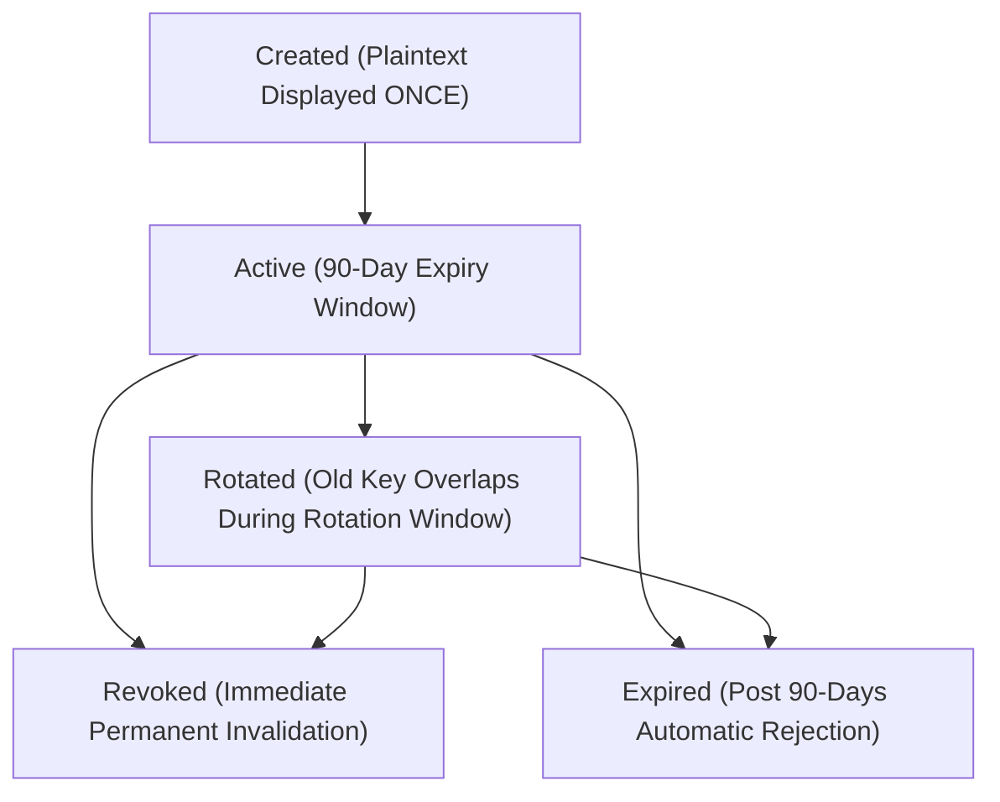
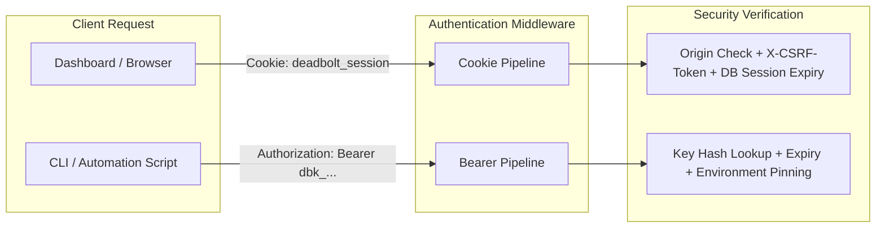

# Access Control, API Key Lifecycle & Webhook Administration Guide

This guide establishes the production operational specifications, security boundaries, and lifecycle contracts for Deadbolt's identity management, role-based access control (RBAC), machine credentials, and webhook integration delivery (Blueprint §20.1, §21, §23, §24, §26 and ADR-14).

---

## 1. Role Hierarchy & Capability Matrix

Deadbolt enforces a strictly monotonic, server-side role hierarchy for human organization members. Every HTTP endpoint and control-plane operation resolves the actor's verified role and verifies required capabilities in PostgreSQL prior to mutation or data retrieval.

### 1.1 Canonical Roles & Capabilities

| Role          | Description                        | Key Capabilities                                                                                                                            | Restricted Boundaries                                                                                       |
| :------------ | :--------------------------------- | :------------------------------------------------------------------------------------------------------------------------------------------ | :---------------------------------------------------------------------------------------------------------- |
| **Viewer**    | Read-only auditor or stakeholder   | `runs:read`, `environments:read`, `events:read`                                                                                             | **No** `payload:read`, **no** `artifacts:write`, **no** execution control, **no** member/key administration |
| **Developer** | Workflow author and builder        | Viewer capabilities + `workflows:read`, `deployments:register`, `deployments:activate_staging`, `runs:create`, `payload:read`               | **No** `deployments:activate_prod`, **no** member administration, **no** worker drain/revoke                |
| **Operator**  | Production execution controller    | Developer capabilities + `runs:control`, `approvals:decide`, `runs:reconcile`, `workers:read`, `workers:drain`, `deployments:activate_prod` | **No** member role promotion or organization deletion                                                       |
| **Admin**     | Environment and team administrator | Operator capabilities + `admin:member`, `admin:project`, `admin:key`, `webhooks:write`, `workers:drain`                                     | Cannot demote, suspend, or delete the last remaining organization Owner                                     |
| **Owner**     | Full organization authority        | Admin capabilities + `org:update`, `org:delete`, unlimited administrative scope                                                             | Retains last-owner invariants; subject to non-bypassable concurrency serialization                          |

### 1.2 Capability Matrix

| Capability                     | Name in Code                   | Viewer | Developer | Operator | Admin | Owner |
| :----------------------------- | :----------------------------- | :----: | :-------: | :------: | :---: | :---: |
| Run Read                       | `runs:read`                    |   ✓    |     ✓     |    ✓     |   ✓   |   ✓   |
| Events Read                    | `events:read`                  |   ✓    |     ✓     |    ✓     |   ✓   |   ✓   |
| Environments Read              | `environments:read`            |   ✓    |     ✓     |    ✓     |   ✓   |   ✓   |
| Payload Read                   | `payload:read`                 |   ✗    |     ✓     |    ✓     |   ✓   |   ✓   |
| Workflows Read                 | `workflows:read`               |   ✗    |     ✓     |    ✓     |   ✓   |   ✓   |
| Deployments Register           | `deployments:register`         |   ✗    |     ✓     |    ✓     |   ✓   |   ✓   |
| Deployments Activate (Staging) | `deployments:activate_staging` |   ✗    |     ✓     |    ✓     |   ✓   |   ✓   |
| Runs Create                    | `runs:create`                  |   ✗    |     ✓     |    ✓     |   ✓   |   ✓   |
| Artifacts Write                | `artifacts:write`              |   ✗    |     ✓     |    ✓     |   ✓   |   ✓   |
| Deployments Activate (Prod)    | `deployments:activate_prod`    |   ✗    |     ✗     |    ✓     |   ✓   |   ✓   |
| Runs Control (Cancel / Pause)  | `runs:control`                 |   ✗    |     ✗     |    ✓     |   ✓   |   ✓   |
| Approvals Decide               | `approvals:decide`             |   ✗    |     ✗     |    ✓     |   ✓   |   ✓   |
| Runs Reconcile                 | `runs:reconcile`               |   ✗    |     ✗     |    ✓     |   ✓   |   ✓   |
| Workers Read                   | `workers:read`                 |   ✗    |     ✗     |    ✓     |   ✓   |   ✓   |
| Workers Drain / Revoke         | `workers:drain`                |   ✗    |     ✗     |    ✓     |   ✓   |   ✓   |
| Webhooks Write                 | `webhooks:write`               |   ✗    |     ✗     |    ✓     |   ✓   |   ✓   |
| Admin Member                   | `admin:member`                 |   ✗    |     ✗     |    ✗     |   ✓   |   ✓   |
| Admin Project                  | `admin:project`                |   ✗    |     ✗     |    ✗     |   ✓   |   ✓   |
| Admin Key                      | `admin:key`                    |   ✗    |     ✗     |    ✗     |   ✓   |   ✓   |
| Org Update                     | `org:update`                   |   ✗    |     ✗     |    ✗     |   ✗   |   ✓   |
| Org Delete                     | `org:delete`                   |   ✗    |     ✗     |    ✗     |   ✗   |   ✓   |

---

## 2. Last-Owner Protection & Concurrency Serialization

### 2.1 The Invariant (INV-LAST-OWNER)

An organization must **never** be rendered ownerless. An organization with zero active owners is unmanageable, violates compliance policies, and leaves orphaned resources.

Deadbolt guarantees that an active Owner can never be removed, demoted, or suspended if they are the sole remaining active Owner of the organization.

### 2.2 Server-Side Defense Mechanisms

1. **Member Role Demotion:**
   - When an administrator attempts to change an Owner's role to Developer, Operator, Viewer, or Admin (`PATCH /v1/organizations/{id}/members/{userId}`), Deadbolt evaluates the count of active owners in the organization.
   - If `count(owners WHERE status = 'ACTIVE') <= 1`, the demotion is rejected with HTTP 403 `LAST_OWNER_DEMOTION_FORBIDDEN`.

2. **Member Suspension:**
   - When an administrator attempts to suspend an Owner (`PATCH /v1/organizations/{id}/members/{userId}/status` with `status: "SUSPENDED"`), Deadbolt evaluates remaining active owners.
   - If `count(owners WHERE status = 'ACTIVE') <= 1`, the suspension is rejected with HTTP 403 `LAST_OWNER_SUSPENSION_FORBIDDEN`.

3. **Member Removal:**
   - When an administrator attempts to remove an Owner (`DELETE /v1/organizations/{id}/members/{userId}`), Deadbolt checks remaining active owners.
   - If `count(owners WHERE status = 'ACTIVE') <= 1`, the removal is rejected with HTTP 403 `LAST_OWNER_REMOVAL_FORBIDDEN`.

4. **Serialized Concurrency Locking:**
   - Under concurrent membership mutations (e.g. two administrators racing to remove two owners simultaneously), naive counts suffer from race conditions.
   - Deadbolt wraps membership mutations in transactional row-level locks on the parent `organizations` row (`SELECT id FROM organizations WHERE id = $1 FOR UPDATE`).
   - All concurrent membership edits for the organization serialize through this lock, ensuring that exactly one last active Owner remains even under heavy concurrency races.

---

## 3. API Key Lifecycle & Environment Scoping

API keys provide automated machine access for CI/CD pipelines, autonomous dispatchers, and system integrations.

### 3.1 Key Lifecycle States



1. **One-Time Plaintext Secret Display:**
   - Upon creation (`POST /v1/environments/{envId}/api-keys`) or rotation (`POST /v1/api-keys/{id}/rotate`), Deadbolt generates a cryptographically secure 256-bit random key with prefix `dbk_live_` or `dbk_stg_`.
   - The plaintext key is returned **once and only once** in the API response.
   - Only the SHA-256 hash (`key_hash`) and an unprivileged prefix/suffix identifier (`key_prefix`, `key_suffix`) are persisted in PostgreSQL.
   - Deadbolt operators and APIs cannot retrieve or reconstruct the secret after the initial creation call.

2. **Strict 90-Day Expiry:**
   - Machine keys are bounded by an expiration timestamp (default: 90 days).
   - If `clock_timestamp() > expires_at`, `AuthenticateAPIKey` rejects the request immediately with HTTP 401 `API_KEY_EXPIRED`.

3. **Rotation & Overlap:**
   - Operators can rotate an active key (`POST /v1/api-keys/{id}/rotate`).
   - A newly generated plaintext key is returned for the replacement record.
   - The original key enters a graceful deprecation window or is immediately revoked per operational policy.

4. **Revocation:**
   - Revoking a key (`DELETE /v1/api-keys/{id}`) commits `revoked_at = clock_timestamp()`.
   - Subsequent requests with the revoked key are rejected with HTTP 401 `API_KEY_REVOKED`.
   - **Self-Invalidating Idempotency Replay Exception:** If a network timeout occurred during the delete/rotate call, an identical replay matching the original request fingerprint is permitted to return the recorded outcome rather than an auth error.

### 3.2 Environment Scoping & Elevation Prevention

- **Environment Isolation:** Every machine API key is pinned to exactly one `environment_id`. Requests attempting cross-environment mutations or mismatched query/header parameters (`X-Environment-ID`) are rejected with HTTP 403 `ENVIRONMENT_MISMATCH`.
- **Capability Elevation Defense:** An API key cannot be created with capabilities exceeding the creator's authority. Attempts to grant unauthorized capabilities return HTTP 403 `CAPABILITY_ELEVATION_FORBIDDEN`.
- **Machine Key Restriction Invariant (Blueprint §24.2):** Machine API keys can **never** hold `approvals:decide` or `runs:reconcile`. Human approvals and reconciliation resolutions represent accountable business acts requiring an identifiable human operator. Key creation requests specifying these capabilities are rejected with HTTP 403 `MACHINE_KEY_UNAUTHORIZED`.

---

## 4. Dual-Mode Authentication Architecture

Deadbolt isolates human sessions from machine integrations through two distinct authentication pipelines:



### 4.1 Human Interactive Sessions (BFF / Web UI)

- **Transport:** HTTP-only, SameSite=Lax, Secure cookie (`deadbolt_session`).
- **CSRF Defense:** Mutating requests (`POST`, `PATCH`, `DELETE`, `PUT`) require a valid `X-CSRF-Token` header cryptographically bound to the session, along with allowlisted `Origin` / `Referer` validation.
- **Session Revocation:** Logout (`POST /api/auth/logout`) or security invalidation commits `revoked_at = clock_timestamp()` in `auth_sessions`. Subsequent calls return HTTP 401 `UNAUTHENTICATED`.
- **Member Status Synchronization:** Inactive or suspended members (`member.status != 'ACTIVE'`) are immediately blocked on all organization-scoped endpoints with HTTP 403 `FORBIDDEN_ORGANIZATION_MEMBERSHIP`.

### 4.2 Machine API Credentials

- **Transport:** HTTP `Authorization: Bearer dbk_<env>_<secret>` header.
- **Stateless Verification:** Keys are verified by computing `SHA-256(rawSecret)` and looking up the active key hash in PostgreSQL using constant-time comparison against nonexistent dummy hashes to defeat timing attacks.
- **Worker Sessions:** Workers authenticate via enrollment-exchanged session tokens (`Bearer dbs_<token>`). Worker revocation (`POST /v1/workers/{id}/revoke`) sets `revoked_at` in `workers` and `worker_sessions`, immediately blocking worker polling and execution with HTTP 403 `WORKER_REVOKED`.

---

## 5. Webhook Administration & Delivery Operations

Deadbolt provides signed, reliable, at-least-once outbound webhooks for orchestrating external event-driven architectures.

### 5.1 Security & Verification Contract

1. **HMAC-SHA256 Signatures:**
   Every outbound webhook request includes the `X-Deadbolt-Signature` header:

   ```http
   X-Deadbolt-Signature: t=1732233600,v1=a1b2c3d4e5f6...,kid=key_abc123
   X-Deadbolt-Timestamp: 1732233600
   X-Deadbolt-Key-ID: key_abc123
   ```

   The signature signature string is `v1 = HMAC-SHA256(secret, "${timestamp}.${rawBody}")`.

2. **Replay Defense:**
   Receivers must reject any webhook request where `|currentTime - timestamp| > 300 seconds` (5-minute tolerance window).

3. **Key Rotation Overlap:**
   When an endpoint signing key is rotated, Deadbolt maintains an overlapping grace period where signatures can be verified against either the active or previous key ID.

4. **SSRF Defense:**
   Outbound HTTP dispatches strictly resolve and validate destination IP addresses before connection establishment, rejecting loopback (`127.0.0.0/8`), link-local (`169.254.0.0/16`), private RFC 1918 subnets, and cloud metadata services (`169.254.169.254`).

### 5.2 Delivery History & Manual Redelivery

The Deadbolt Dashboard and API provide full operational visibility into delivery attempts:

- **Delivery Auditing:** Every dispatch attempt records the HTTP status code, request duration, response body snippet (truncated to 1 KB), and error trace.
- **Idempotent Retry Pinning:** Automatic retries use exponential backoff with jitter up to the configured retry limit.
- **Manual Redelivery with Destination Choice:**
  Operators can manually re-dispatch any historical webhook delivery (`POST /v1/webhook-deliveries/{deliveryId}/redeliver`):
  1. **Event Identity Preservation:** The new delivery attempt strictly preserves `event_id`, `event_type`, `run_id`, and `payload` from the original event.
  2. **Default Destination:** If no body is provided, the redelivery targets the original endpoint.
  3. **Explicit Destination Choice:** Operators can specify an alternative endpoint destination:
     ```json
     {
       "endpointId": "3fa85f64-5717-4562-b3fc-2c963f66afa6"
     }
     ```
  4. **Validation & Conflicts:**
     - If the target endpoint is inactive (`is_active = false`), the API returns HTTP 409 `ENDPOINT_INACTIVE`.
     - If a machine key attempts cross-environment redelivery, the API returns HTTP 403 `ENVIRONMENT_MISMATCH`.
